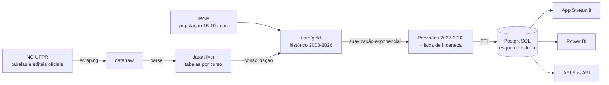

# UFPR Analytics — Relação Candidato x Vaga

Projeto 1 da **Liga de Data Science da UFPR**. Prevê a procura pelos cursos de graduação da UFPR no vestibular e aponta quais cursos correm risco de **sobra de vagas**.

**App:** [Simulador e risco de sobra 2027 (Streamlit)](https://ufpr-analytics-rvhpwhnd523igz75r7vpfs.streamlit.app/) · **Site da Liga:** [soaressst.github.io/liga-data-science-site](https://soaressst.github.io/liga-data-science-site/)

## Resultado principal

Para o **Vestibular 2027**, entre os 109 cursos com histórico suficiente:

| Risco de sobra | Cursos | Critério (candidatos por vaga previstos) |
|---|---|---|
| Sobra certa | 32 | abaixo de 1 |
| Risco alto | 13 | 1 a 1,5 |
| Atenção | 9 | 1,5 a 2 |
| Baixo | 55 | 2 ou mais |

A sobra se concentra no **interior**: 7 dos 11 cursos de Matinhos e todos os 3 de Jandaia do Sul estão em "sobra certa". Também aparece em **engenharias de nicho**: Eng. de Aquicultura de Palotina teve 5 candidatos para 48 vagas.

## O que os dados mostram

- **A procura caiu e só se recuperou em parte.** Os inscritos ficaram entre 40 e 50 mil de 2003 a 2017, caíram para 30,6 mil em 2021 e voltaram a 39,6 mil em 2026. Para 2027, a UFPR divulgou 43,3 mil inscritos, já com a prova em fase única.
- **A queda começou antes da pandemia** (−24% de 2017 a 2020) e foi maior no interior e nos cursos noturnos.
- **Desde 2025, a UFPR corta as vagas** de cursos de baixa procura depois das inscrições. Por isso o projeto mede a procura contra as **vagas de referência**, que são as vagas de antes dos cortes.

Detalhes em [`analises/01_exploratoria.md`](analises/01_exploratoria.md).

## Como sabemos que o indicador funciona

Usamos os **relatórios oficiais de ocupação das vagas** do NC-UFPR (2016–2022) e comparamos 615 pares curso-ano:

| Candidatos por vaga | Terminaram com vaga sem preencher |
|---|---|
| abaixo de 1 | **100%** |
| 1 a 1,5 | 57% |
| 1,5 a 2 | 9% |
| acima de 3 | 0–2% |

Detalhes em [`analises/02_validacao_sobra.md`](analises/02_validacao_sobra.md).

## O modelo

- **Suavização exponencial simples** por curso.
  - Testado contra os anos reais, ele empata com a regra "repetir o último ano" e erra cerca de **metade** do Holt (modelo com tendência), que era o modelo da primeira versão do projeto.
  - A procura de cada curso tende a voltar ao nível anterior de um ano para o outro (correlação de −0,41 entre variações seguidas). Por isso projetar tendência piora a previsão.
- **Faixa de incerteza de 80%:** calculada pelos erros reais do modelo um ano à frente. O valor real costuma ficar entre 0,6× e 1,4× a previsão.
- **Testado e descartado:** ajustar a previsão pelo total de inscritos do ano não melhorou o erro.

## Dados

Todos os dados são **oficiais e agregados por curso**. Não usamos nenhuma lista nominal de candidatos.

| Período | O quê | Fonte |
|---|---|---|
| 2003, 2005–2017, 2020 | Candidatos, treineiros e vagas | Tabelas de relação candidato/vaga do NC-UFPR |
| 2021–2027 | Vagas por curso | Quadro de vagas dos guias e editais |
| 2021–2026 | Candidatos por curso | Base consolidada pela Liga. Os totais conferem com os divulgados pela UFPR |
| 2016–2023 | Aprovados por curso | Relatórios de ocupação das vagas |

Cada arquivo baixado fica intocado em `data/raw/nc_ufpr/`, com link, data e hash no `manifesto.csv`.

**Erros corrigidos na base anterior:**
- o cálculo descontava os treineiros duas vezes;
- 2019 tinha só os convocados da 2.ª fase;
- 2020 tinha só a ampla concorrência;
- as "vagas impossíveis" de 2021 eram notas de rodapé do guia grudadas nos números.

## Arquitetura



## Estrutura e como rodar

```
pipeline/   scraping_nc → parse_nc → consolidar_historico → modelo_previsao → etl_ingestao
analises/   análises reproduzíveis (relatórios .md + scripts que geram números e gráficos)
data/       raw (fontes oficiais) → silver (tabelas por curso) → gold (histórico e previsões)
sql/        mudanças no banco, em ordem
app.py      app Streamlit · backend/ API FastAPI · frontend/ site da Liga
```

Rode os comandos a partir da pasta raiz, com Python 3.11 ou mais novo:

```bash
pip install -r requirements.txt
python -m pipeline.scraping_nc            # baixa as fontes oficiais (pula o que já existe)
python -m pipeline.parse_nc
python -m pipeline.consolidar_historico
python -W ignore -m pipeline.modelo_previsao
python -m streamlit run app.py
```

O acesso ao banco usa as variáveis de [`.env.example`](.env.example). O `etl_ingestao` grava no banco, então rode só quando quiser atualizá-lo.

## Limitações

- **Os candidatos por curso de 2021–2026** vêm da base consolidada pela Liga, porque o NC não publica essa tabela por curso. Os totais e os 15 cursos mais concorridos de 2025 conferem com o oficial.
- **Não há dados por curso** de 2004 e 2018. Em 2019 o NC só publicou os convocados da 2.ª fase.
- **O histórico de cada curso** é montado ligando nomes que mudaram de formato ao longo dos anos. Nomes ambíguos ficam de fora.
- **A sobra medida vale para o vestibular.** Parte dessas vagas pode ser preenchida depois pelo SiSU ou por vagas remanescentes.
- **A validação vai até 2022.** Ainda não há relatório de ocupação dos anos com corte de vagas.

## English summary

**UFPR Analytics: Applicant-to-Seat Ratio** is the first project of the Data Science League at the Federal University of Paraná (UFPR, Brazil). It forecasts demand for each undergraduate program in the university entrance exam and flags programs at risk of **unfilled seats**.

- **Data:** official, program-level public data scraped from UFPR's admissions office (2003–2027), plus IBGE demographic data. No individual applicant data is used.
- **Pipeline:** Python scraping and parsing → raw/silver/gold layers → PostgreSQL star schema → Streamlit app, Power BI report and FastAPI service.
- **Model:** simple exponential smoothing per program, with an 80% uncertainty band from real one-year-ahead errors. It halves the error of the previous trend-based (Holt) model.
- **Validation:** against official seat-occupancy reports (615 program-year pairs, 2016–2022), every program with fewer than 1 applicant per seat ended with unfilled seats.
- **Main result:** for the 2027 exam, 32 of 109 programs are forecast to have unfilled seats for certain and 13 more are at high risk, concentrated in campuses outside Curitiba.
