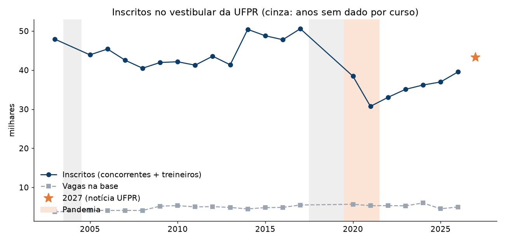
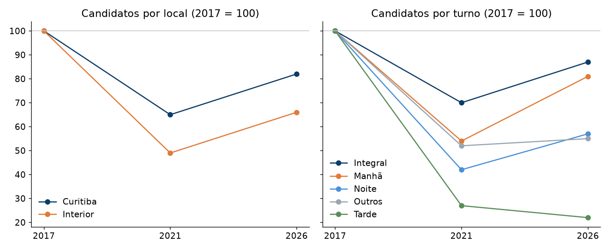
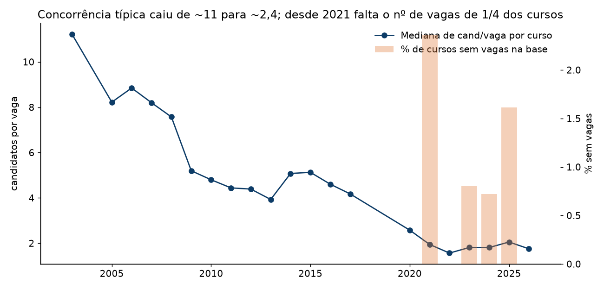

# Análise exploratória — procura pelo vestibular da UFPR (2003–2026)

*29/10/2026. Base: `data/gold/historico_candidato_vaga.csv` (NC-UFPR oficial 2003–2020 + base da Liga 2021–2026), sem os cursos de oficiais da PM/Bombeiros. Números reproduzíveis com `python -m analises.exploratoria`.*

> **Atualização (29/10/2026, depois desta análise):** as vagas de 2021–2026 foram completadas com o quadro oficial de cada guia ou edital (`pipeline/parse_nc.py`). Agora faltam de 0 a 3 cursos por ano, e o total confere com o oficial (2024: 5.317; 2026: 4.465, igual à totalização do edital). O número de 5.313 das notícias inclui outras modalidades. Dois achados novos:
> 1. **Os valores "impossíveis" de 2021 (6.030 vagas etc.) vinham do próprio guia.** São notas de rodapé sobrescritas grudadas no número: "60²⁹ 0 60³⁰" virou "6029 0 6030". Corrigido.
> 2. **A partir de 2025, o edital publicado corta as vagas de cursos de baixa procura até o número de candidatos.** Exemplo: Eng. de Aquicultura de Palotina tinha 48 vagas até 2024 e passou a 5 em 2025 (5 candidatos). Em 2025, 31 cursos têm candidatos = vagas e nenhum fica abaixo de 1; em 2026, são 11. A partir de 2025, "cand/vaga < 1" deixa de medir a sobra. Esses casos estão marcados na coluna `Vagas_Ajustadas_Demanda` do histórico.
>
> A seção 4 abaixo descreve a situação **antes** dessa correção.

## Resumo

1. **A procura caiu forte e só se recuperou em parte.** Os inscritos ficaram entre 40 e 50 mil de 2003 a 2017, caíram para 38,5 mil em 2020 e 30,6 mil em 2021, e voltaram a 39,6 mil em 2026. Para 2027 a UFPR divulgou 43,3 mil inscritos.
2. **As vagas quase não mudaram** (cerca de 4 a 5,7 mil por ano). A queda na concorrência veio da procura, não de vagas a mais.
3. **A queda foi desigual.** Interior, noite e tarde caíram mais e recuperaram menos. Engenharias de nicho perderam cerca de 80% dos candidatos e não voltaram.
4. **A variação de cada curso volta, em vez de seguir uma tendência.** Isso explica por que o Holt errou mais que "repetir o último ano".
5. **Falta o número de vagas de cerca de 1/4 dos cursos em 2021–2026**, quase sempre cursos de baixa procura. Por isso as previsões atuais **subestimam** os cursos com sobra de vagas.

## 1. Inscritos e vagas por ano

| Ano | Inscritos | Vagas (base) | Mediana cand/vaga por curso |
|---|---|---|---|
| 2003 | 47.924 | 3.727 | 11,2 |
| 2010 | 42.144 | 5.334 | 4,8 |
| 2017 | 50.593 | 5.494 | 4,2 |
| 2020 | 38.453 | 5.690 | 2,6 |
| 2021 | 30.564 | 4.897* | 2,5 |
| 2026 | 39.565 | 4.449* | 2,4 |

\* Vagas incompletas na base (ver seção 4).

- **Os inscritos conferem com o que a UFPR divulgou**: 38.453 em 2020, 36.970 em 2025 e 39.565 em 2026 (soma de concorrentes e treineiros).
- **Queda em duas etapas.** De 2017 para 2020 houve −24%, *antes* da pandemia. As provas de 2019 para o vestibular de 2020 foram em novembro de 2019. De 2020 para 2021, já na pandemia, mais −21%.
- **A causa da primeira etapa não está confirmada.** Hipóteses a investigar: a prova em duas fases, mais vagas oferecidas pelo SiSU/Enem e a queda da população jovem no Paraná. Em 2027 a UFPR adotou fase única. Segundo o Núcleo de Concursos, as duas fases afastavam candidatos, sobretudo os que moram longe das cidades de prova. Os inscritos subiram 9,4%.
- **A concorrência típica caiu também porque o número de cursos subiu**, de 63 para 181. Entraram campi novos e houve desmembramentos, como os cursos ABI a partir de 2023. O mesmo total de candidatos ficou dividido entre mais opções.

## 2. Quem perdeu mais candidatos

Índice de candidatos (2017 = 100), considerando os 53 cursos com dado em 2017, 2021 e 2026:

| Grupo | 2021 | 2026 |
|---|---|---|
| Curitiba | 66 | 83 |
| Interior | 49 | 66 |
| Integral | 70 | 87 |
| Manhã | 54 | 81 |
| Noite | 43 | 55 |
| Tarde (3 cursos) | 27 | 22 |

- **51 desses 53 cursos perderam candidatos** de 2017 a 2021.
- **Maiores quedas:** Eng. Industrial Madeireira (−86%), Eng. Agrícola de Jandaia do Sul (−86%), Eng. de Aquicultura de Palotina (−80%), Eng. Civil de Pontal do Paraná (−79%), Letras-Francês (−78%) e Eng. Florestal (−77%). Nenhum desses cursos se recuperou até 2026.
- **Maiores recuperações de 2021 a 2026:** Terapia Ocupacional (+96%), Gestão da Informação (+86%), Farmácia (+81%) e Direito, nos dois turnos (+64% a +66%).

## 3. Como a procura de um curso muda de um ano para o outro

Foram analisados 1.023 pares de anos seguidos, por curso:

- **O efeito comum do ano explica só 19% da variação.** O resto é próprio de cada curso.
- **A variação própria de um ano tende a se desfazer no ano seguinte** (correlação de **−0,41**). Um curso que sobe além do geral num ano costuma cair no seguinte, e vice-versa.
- **Repetir os candidatos do ano anterior erra, em média, 26%** por curso.

**O que isso significa para o modelo:**
- Projetar a tendência recente (Holt) amplifica um ruído que depois se desfaz. É o oposto do que funciona.
- Funcionam métodos que **suavizam**: média ponderada dos últimos anos, ou uma fatia estável do total de inscritos.
- Com erro da ordem de ±25%, a previsão de cada curso deve vir com **faixa de incerteza**, não com um número exato.

## 4. Problemas de dados encontrados

- **Vagas faltando em 2021–2026:** de 11% a 29% dos cursos por ano não têm vagas na base. Exemplos de 2025: Ciências Exatas de Jandaia do Sul, Palotina e Pontal (6 a 8 candidatos), Eng. de Alimentos de Jandaia (5) e Eng. de Aquicultura de Pontal (4). Esses cursos claramente teriam sobra de vagas, mas ficam fora da relação candidato/vaga. **As 7 previsões de sobra estão subestimadas.**
- **Total de vagas abaixo do divulgado:** a base soma 4.449 vagas em 2026, contra 5.313 divulgadas pela UFPR.
- **Anos sem dado por curso:** 2004 e 2018 (nenhuma tabela pública encontrada) e 2019 (só os convocados da 2.ª fase).

## Próximos passos sugeridos

1. **Completar as vagas de 2021–2026 a partir dos editais oficiais.** Cada edital tem o quadro de vagas por curso. É o passo de maior impacto, porque traz de volta justamente os cursos com sobra de vagas.
2. **Remodelar a previsão:** fatia suavizada de cada curso × total de inscritos projetado. Para 2027 o total já é conhecido (43.290). A previsão deve sair com faixa de incerteza, e o modelo precisa ser testado contra "repetir o último ano".
3. **Confirmar o que é "sobra".** Ter cand/vaga < 1 no vestibular não é o mesmo que ter vagas ociosas: há chamadas complementares, SiSU e vagas remanescentes. Os relatórios oficiais de **ocupação das vagas** (2016–2023) podem validar o indicador.
4. **Investigar a queda de 2017→2020** com os editais (duas fases, divisão de vagas com o SiSU) e com dados de demografia/INEP.

## Fontes externas

- [Vestibular da UFPR tem 39.566 inscritos, número mais alto desde a pré-pandemia (Bem Paraná)](https://www.bemparana.com.br/noticias/parana/vestibular-da-ufpr-tem-39-566-inscritos-numero-mais-alto-desde-a-pre-pandemia/)
- [Vestibular da UFPR bate recorde da década e recupera patamar pré-pandemia (Tribuna PR)](https://www.tribunapr.com.br/noticias/vestibular-da-ufpr-bate-recorde-da-decada-e-recupera-patamar-pre-pandemia-com-quase-433-mil-inscritos/)
- [UFPR 2020: mais de 38 mil inscritos (Vestibulando Web)](https://www.vestibulandoweb.com.br/vestibular/ufpr-2020-mais-de-38-mil-inscritos-fazem-prova-neste-domingo-27/amp/)
- [Vestibular UFPR 2024 tem mais de 36 mil inscritos (Estratégia)](https://vestibulares.estrategia.com/portal/noticias/vestibular-ufpr-2024-tem-mais-de-36-mil-inscritos/)
