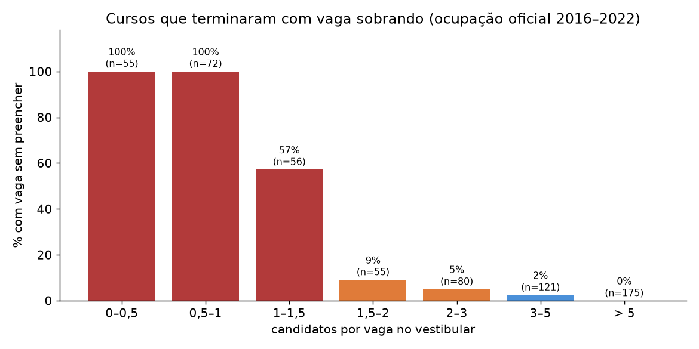

# Validação do indicador de sobra de vagas

*29/10/2026. Reproduzível com `python -m analises.validacao_sobra`.*

## Pergunta

O projeto marca um curso "em sobra" quando há **menos de 1 candidato por vaga** no vestibular. Esses cursos realmente terminam com vagas sem preencher?

## Dados

- **Relatórios oficiais de ocupação das vagas** do NC-UFPR ([Relatórios estatísticos](https://servicos.nc.ufpr.br/PortalNC/RelatoriosEstatisticos)), de 2016 a 2023. Trazem, por curso e categoria de cota, quantos candidatos foram aprovados:
  - na **chamada geral**;
  - no **resumo final**, que soma a chamada geral e todas as chamadas complementares.

  São dados agregados, sem nomes. Os arquivos brutos estão em `data/raw/nc_ufpr/<ano>/ocupacao_*.html` e a tabela por curso em `data/silver/nc_ocupacao_por_curso.csv`.
- **Definição de "sobrou vaga":** o total de aprovados no resumo final ficou **abaixo das vagas** do curso. Ou seja, mesmo depois de todas as chamadas, faltou gente aprovada para preencher o curso.
  - Em cursos procurados, o resumo final passa das vagas, porque quem não faz a matrícula é substituído.
  - O resumo final existe de 2016 a 2022. Dá **615 pares curso-ano** com relação candidato/vaga oficial (2016, 2017, 2020, 2021 e 2022).

## Resultado

| Cand/vaga no vestibular | Pares curso-ano | Terminaram com vaga sobrando | Ocupação final mediana* |
|---|---|---|---|
| 0 – 0,5 | 55 | **100%** | 18% |
| 0,5 – 1 | 72 | **100%** | 51% |
| 1 – 1,5 | 56 | **57%** | 86% |
| 1,5 – 2 | 55 | 9% | 113% |
| 2 – 3 | 80 | 5% | 119% |
| 3 – 5 | 121 | 2% | 123% |
| > 5 | 175 | 0% | 121% |

\* Aprovados no resumo final ÷ vagas. Passa de 100% porque inclui as substituições de quem não fez a matrícula.

**Cada limite de cand/vaga como alarme de sobra:**

| Limite | Sobras detectadas | Recall | Alarmes falsos | Precisão |
|---|---|---|---|---|
| < 1 | 124 de 172 | 72% | 0 | **100%** |
| < 1,5 | 160 de 172 | **93%** | 21 | 88% |
| < 2 | 165 de 172 | 96% | 65 | 72% |

## Conclusões

1. **O indicador "< 1" é confiável, mas conservador.** Todos os cursos que ele marcou terminaram mesmo com vagas sobrando: nenhum alarme falso. Mas ele só pega 72% das sobras.
2. **Ter mais candidatos do que vagas não garante preencher o curso.** Entre 1 e 1,5 candidato por vaga, 57% dos cursos sobraram vaga, porque nem todo inscrito comparece, é aprovado ou faz a matrícula.
3. **Proposta de classificação de risco:**
   - **< 1: sobra certa.** Nos dados, aconteceu 100% das vezes.
   - **1 a 1,5: risco alto.** Mais da metade dos cursos sobrou vaga.
   - **1,5 a 2: atenção.** Cerca de 1 em cada 10 cursos sobrou vaga.
   - **≥ 2: baixo risco.**

## Limitações

- A validação vai até 2022. Desde 2025 o edital corta as vagas de cursos de baixa procura (ver `01_exploratoria.md`), por isso o projeto mede cand/vaga contra as vagas de referência. Ainda não há relatório de ocupação para conferir essa regra nos anos com corte.
- "Sobrou vaga" aqui vale **para o vestibular**. Essas vagas podem ter sido preenchidas depois por outras formas de ingresso (SiSU, vagas remanescentes), que não entram nesta conta.
