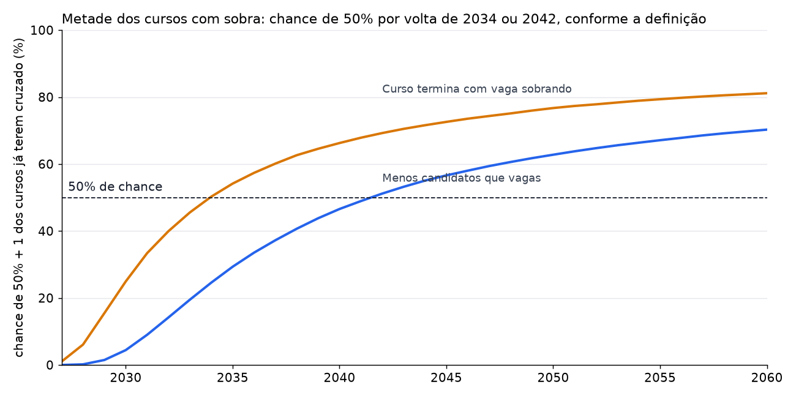

# Em que ano 50% + 1 dos cursos terão sobra?

**Resposta: por volta de 2042**, medindo cursos com menos candidatos do que vagas. A incerteza é grande: há 50% de chance de ocorrer entre 2035 e depois de 2060, e 30% de chance de não ocorrer até 2060. Se "sobra" significar o curso terminar com vaga sem preencher, o ano central é **2034**.

Reproduzir: `python -W ignore -m analises.ano_maioria_sobra`. Cenários separados: `python -W ignore -m analises.projecao_maioria_sobra`.

## O resultado depende do que se chama de sobra

Base: 141 cursos com candidatos em 2026, 71 formam a maioria.

| Definição | Hoje | Ano central | Faixa de 80% | Até 2030 | Até 2035 | Até 2040 | Até 2050 | Até 2060 |
|---|---|---|---|---|---|---|---|---|
| **Menos candidatos do que vagas** | 21% dos cursos | **2042** | 2032 a depois de 2060 | 4% | 29% | 47% | 62% | 70% |
| Curso termina com vaga sem preencher | cerca de 38% (estimado) | **2034** | 2029 a depois de 2060 | 25% | 54% | 66% | 77% | 81% |
| 50% de todas as vagas sem preencher | cerca de 15% (estimado) | depois de 2060 | 2043 a depois de 2060 | 0% | 0% | 5% | 23% | 38% |

A segunda definição importa porque a sobra real começa antes: entre 1 e 1,5 candidato por vaga, 57% dos cursos terminaram com vaga sobrando. Nos relatórios oficiais de ocupação, 46% dos cursos terminaram com vaga sobrando em 2022, o último ano disponível (12% em 2017).

## Como chegamos ao ano

1. Testamos 8 formas de projetar o nível comum da procura em 58 pares de ano de corte e ano previsto, com 3 anos ou mais de distância, além de repetir o percentual atual como referência.
2. Cada projeção recebeu um peso pelo seu erro nesse teste (1 / erro quadrático).
3. Simulamos 4.000 futuros por projeção, com os choques anuais do histórico e as diferenças entre cursos.
4. Juntamos as simulações conforme os pesos. O ano é o primeiro em que o limite é cruzado.

| Projeção | Tendência ao ano | Peso | Ano mediano | Faixa de 80% |
|---|---|---|---|---|
| Queda média de 2017–2026 | −8,8% | 13,5% | 2033 | 2030 a 2039 |
| Queda média de todo o histórico | −5,2% | 14,2% | 2037 | 2031 a 2050 |
| Componentes não observados, com deriva | −4,8% | 13,1% | 2038 | 2032 a 2053 |
| Componentes não observados, tendência local | −4,8% | 9,6% | 2038 | 2032 a 2053 |
| Queda histórica amortecida | −3,8% nos primeiros 5 anos | 13,2% | 2045 | 2032 a depois de 2060 |
| Sem tendência | 0% | 12,4% | depois de 2060 | 2038 a depois de 2060 |
| Ritmo dos últimos 5 anos | 0% | 10,6% | depois de 2060 | 2038 a depois de 2060 |
| População de 15 a 19 anos (IBGE) | +0,8% nos primeiros 5 anos | 13,4% | depois de 2060 | 2040 a depois de 2060 |

## Sensibilidade

| Mudança | Ano central | Faixa de 80% |
|---|---|---|
| Base (141 cursos) | 2042 | 2032 a depois de 2060 |
| Só cursos com 3 anos ou mais de dados (109) | 2043 | 2033 a depois de 2060 |
| Incluindo a alta de 9% nos inscritos de 2027 | 2044 | 2033 a depois de 2060 |

## Limites

- **Os pesos quase não diferenciam os métodos** (de 10% a 14%). O teste tem poucos períodos independentes, e nenhum método se destacou.
- **Todos erraram rupturas.** Em projeções de 6 anos ou mais, os métodos subestimaram o percentual em cerca de 17 pontos, porque partiram de antes da queda de 2017–2022. Uma nova ruptura anteciparia o ano.
- **O ano central é uma mediana entre cenários muito diferentes.** A distribuição é larga e tem dois grupos: com queda, por volta de 2033 a 2045; sem queda, depois de 2060.
- **A segunda e a terceira definições vêm de relações medidas até 2022**, antes dos cortes de vagas de 2025. Não há relatório de ocupação mais recente.
- **As vagas ficam fixas nas vagas de referência.** A UFPR já corta vagas e troca cursos, e pode continuar. Contra as vagas do edital, o indicador dificilmente chegaria à maioria, porque os cortes aproximam vagas e candidatos.
- **A projeção do IBGE é a revisão de 2018**, a disponível na tabela usada.
